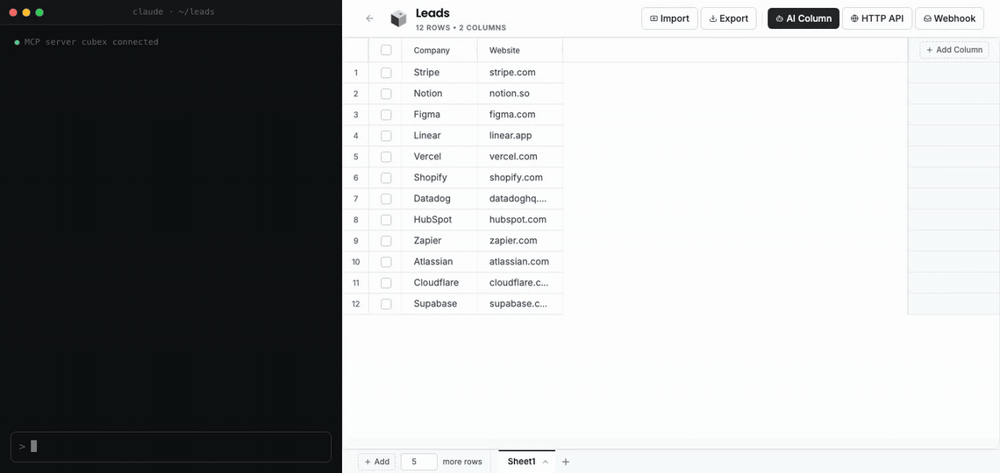
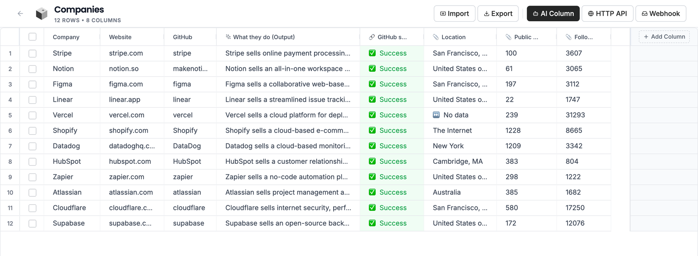
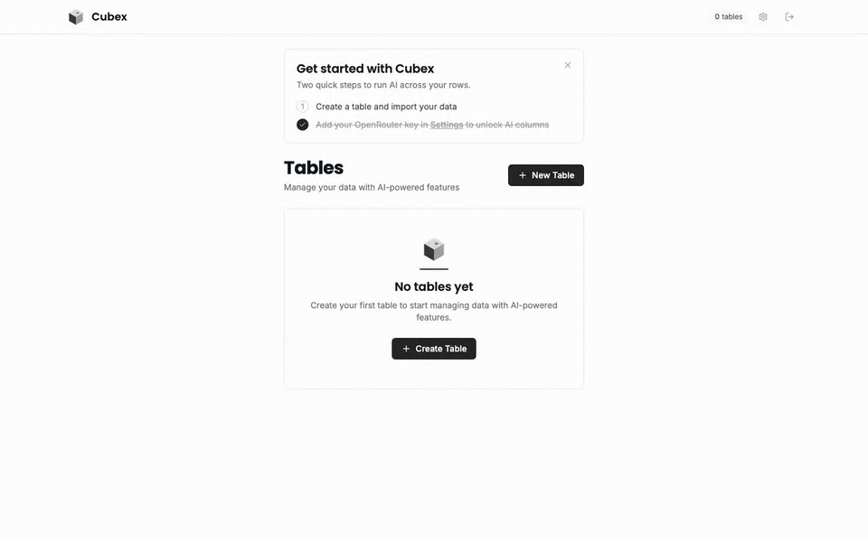
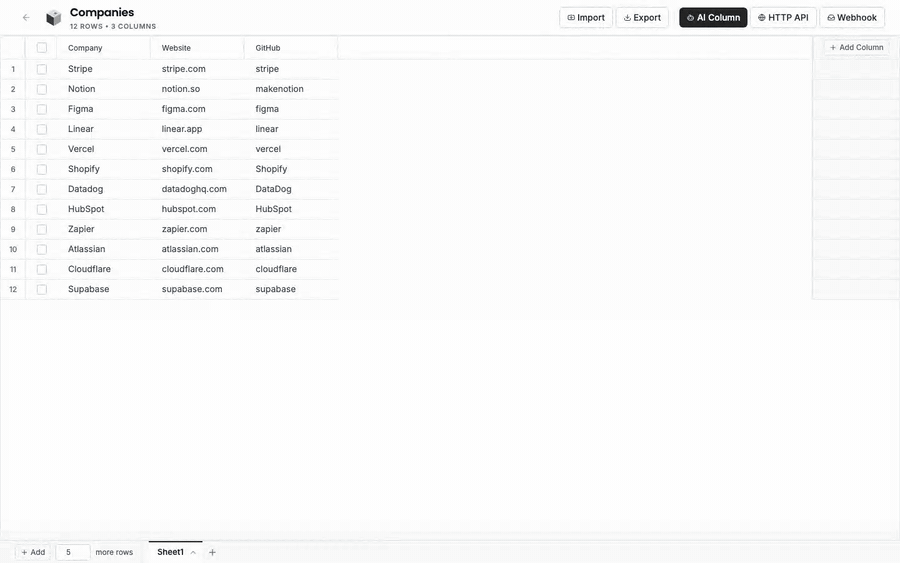
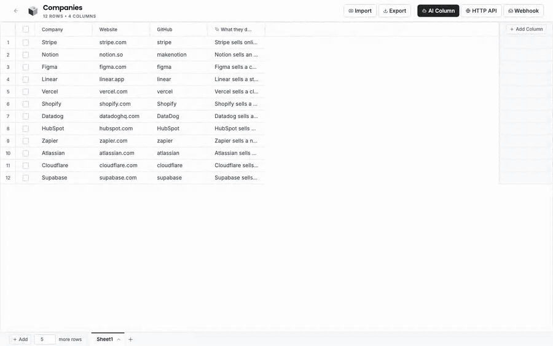
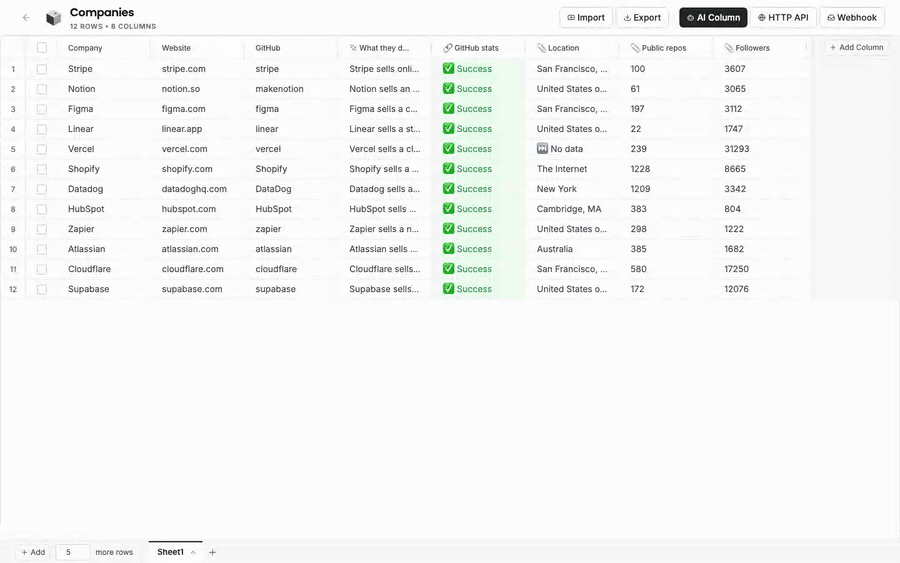

<p align="center">
  
</p>

<h1 align="center">Cubex</h1>

<p align="center">
  <strong>A self-hosted alternative to <a href="https://www.clay.com">Clay</a> that your AI agent can run for you.</strong>
</p>

<p align="center">
  A spreadsheet where a column can be an AI prompt, an API call or an enrichment, run with your own keys instead of credits.<br>
  Connect Claude Code, Cursor, Codex or Claude Desktop over MCP and ask for the work in plain words.
</p>

<p align="center">
  <a href="https://github.com/gurmohitghuman/cubex/releases"></a>
  <a href="LICENSE"></a>
  <a href="#install"></a>
  <a href="docs/configuration.md#your-data-and-backups"></a>
</p>

<p align="center">
  <a href="#install"><strong>Install</strong></a> ·
  <a href="#how-it-works"><strong>How it works</strong></a> ·
  <a href="docs/mcp.md"><strong>Agents and API</strong></a> ·
  <a href="docs/enrichments.md"><strong>Enrichments</strong></a> ·
  <a href="docs/self-hosting.md"><strong>Run it on a server</strong></a>
</p>

<p align="center"><strong>Works with your agent over MCP</strong></p>
<p align="center">
  <a href="docs/mcp.md" title="Claude Code and Claude Desktop"></a>&nbsp;&nbsp;&nbsp;&nbsp;&nbsp;&nbsp;
  <a href="docs/mcp.md" title="Cursor"><picture><source media="(prefers-color-scheme: dark)" srcset=".github/logos/cursor-for-dark.svg"></picture></a>&nbsp;&nbsp;&nbsp;&nbsp;&nbsp;&nbsp;
  <a href="docs/mcp.md" title="Codex by OpenAI"><picture><source media="(prefers-color-scheme: dark)" srcset=".github/logos/openai-blossom-white.svg"></picture></a>&nbsp;&nbsp;&nbsp;&nbsp;&nbsp;&nbsp;
  <a href="docs/mcp.md" title="Model Context Protocol: any MCP client"></a>
</p>

<p align="center"><strong>Fills columns with</strong></p>
<p align="center">
  <a href="https://openrouter.ai" title="OpenRouter: 300+ AI models"><picture><source media="(prefers-color-scheme: dark)" srcset=".github/logos/openrouter-volt.svg"></picture></a>&nbsp;&nbsp;&nbsp;&nbsp;&nbsp;&nbsp;
  <a href="docs/enrichments.md" title="treg.to: enrichments"></a>
</p>



Import a CSV, then add columns that fill themselves row by row. Do it by clicking in the browser, or tell your agent:

> "Import leads.csv into a new table called Leads. Add an AI column that scores each company 1 to 10 for fit, using /company and /domain. Try it on 5 rows, show me the results, then run it on the rest and tell me how many scored 8 or more."

- **AI columns.** A prompt for each row that uses other columns, on any of 300+ models through your own [OpenRouter](https://openrouter.ai) key.
- **HTTP API columns.** Call any JSON API once per row and turn fields of the answer into columns.
- **Enrichments.** Work emails, phone numbers, and person and company data through [treg.to](https://treg.to), within limits you set.
- **Waterfalls.** One value per row from several sources in turn (your other sheets, treg tools, AI prompts, your own APIs), paying only for the steps a row reaches.
- **Clean data, free.** Fix names, split first and last names, drop Inc and LLC from company names, check emails, turn websites into domains and format phone numbers, with no AI and no credits.
- **Formulas, free.** Work a column out from each row with a JavaScript formula: pick the work email out of an API response, join names, do math. Describe it and AI writes the formula once; every row after that costs nothing.
- **Lookups, free.** Bring values from another sheet: a company's industry onto its people, whether a lead is already in another list, how many orders match. Match whole values or text inside them.
- **Setups.** Save a chain of filled columns (the prompts, models, requests, formulas and rules) once, then build the same columns on a new client's sheet in one go. Each step runs once the columns it reads are filled.
- **Remove duplicates, free.** Find rows that repeat an email, a domain, a phone number, a company or any columns you pick, see them before anything goes, and keep the first, last or most filled-in row of each. Or keep it that way: auto-dedupe keeps one row per key as rows arrive from a webhook, an import or an agent.
- **Webhooks.** Every JSON event sent to a sheet's secret URL becomes a new row.
- **Agent access (MCP).** Your agent can do the work for you, with only the permissions you give it. There's also a REST API.
- **A real spreadsheet underneath.** Several sheets per table, CSV import and export, sort, filters (by text, numbers, or a run's state, like the rows that failed), saved views (filters and hidden columns, exported on their own), search across every row, up to a million rows per sheet.
- **A trash and a history.** Deleted rows, sheets and tables wait 30 days in the trash, ready to restore. Each sheet's History shows what changed and who changed it: you in the app, or which agent.

**Your data stays on your machine,** in one SQLite file. Cubex only calls OpenRouter, the APIs you set up, and treg.to ([what it sends, and when](docs/configuration.md#what-cubex-connects-to)).

## Install

On macOS or Linux (on Windows, inside WSL2):

```bash
curl -fsSL https://raw.githubusercontent.com/gurmohitghuman/cubex/main/install.sh | bash
```

It takes a minute or two and needs about 1.5 GB of free memory while it builds. Everything goes into `~/.cubex`, including a private copy of Node.js, so your own Node, if you have one, is never used or changed.

Only this computer can open Cubex until you change that. To open it from other devices on your network, add `--public`. The installer then generates your password and prints it:

```bash
curl -fsSL https://raw.githubusercontent.com/gurmohitghuman/cubex/main/install.sh \
  | bash -s -- --public
```

- **On a server reachable from the internet,** keep the default and put HTTPS in front. [Run Cubex on your own server](docs/self-hosting.md) walks through it step by step.
- **More options:** it installs the latest [release](https://github.com/gurmohitghuman/cubex/releases), and `--ref main` follows the newest code instead. `--port` and `--dir` change the port and the folder, and `--help` lists everything.
- **Coolify, Docker or from source:** see [Other ways to run Cubex](docs/other-ways-to-run.md).

## Get started

1. Open http://localhost:3002. **Whoever opens Cubex first chooses the password,** unless `INITIAL_PASSWORD` is set (`--public` sets it for you).
2. For AI columns, create a key at [openrouter.ai/keys](https://openrouter.ai/keys) (OpenRouter bills you directly for what your runs use). Add it and pick a default model in **Settings → AI**. Cubex never picks a model for you.
3. For enrichments, add a treg team API key in **Settings → Enrichment**. The [enrichments guide](docs/enrichments.md) walks through it.

Want to look around first? Click **Try with sample data** on the empty dashboard (or in **New Table**). Cubex makes a table of 25 made-up leads, at `.example` addresses so none of them is a real person or company, with a few messy values on purpose. A clean column and a formula column are already filled, for free, and a card above the grid shows the duplicate hiding in the list. The AI column is set up but not run: pick your model and try it on 5 rows. Delete the table when you're done; it goes to the trash like any other.

There's one account and no email, so there's no reset link. If you forget the password, run `cubex reset-password` on the computer Cubex runs on. Changing or resetting the password signs out every browser.

Cubex keeps running in the background and starts again after a restart: on macOS when you log in, on Linux when the computer starts. If the installer can't set that up, it tells you the one command that does. The `cubex` command does the rest:

| Command | What it does |
|---|---|
| `cubex status` | Whether Cubex is running, its address and version |
| `cubex open` | Open Cubex in your browser |
| `cubex stop`, `cubex start`, `cubex restart` | Stop, start or restart it |
| `cubex logs` | Follow the server log |
| `cubex update` | Update to the latest release; your data and settings are kept |
| `cubex config` | Show the settings file, `~/.cubex/config.env` ([every setting](docs/configuration.md)) |
| `cubex reset-password` | Choose a new password |
| `cubex uninstall` | Remove Cubex but keep your data (`--delete-data` removes that too) |

## How it works



### Import

Create a table, then import a CSV or start typing.



### AI column

Click **AI Column**, name it, and write what you want. Type `/` to use another column's value. Try it on 5 rows, check the results, then run it on the rest.

- **Starters.** Not sure what to write? Start from a ready prompt: qualify (YES or NO), classify, write an opener, a lead score from 1 to 10, or a company profile. Each is written with your sheet's own columns; fill in the parts in square brackets.
- **Web search.** Turn on web search, or "fetch URLs from referenced columns", when the model needs current information. Pick the search engine and limit the searches per row, since search fees are usually most of the cost. Each row's "(Data)" cell shows what it searched for and what it cost.
- **Control.** Cells fill in live while a run works. Pause, resume or stop it. The column's menu says how many rows each run takes and shows its cost before it starts: **Run N empty or out-of-date rows** (never run, or the row's input cells changed since its result was made), **Retry N failed rows** and **Force run all N rows**. A column with failed rows says **N failed, retry** in its header: one click runs them again. Hover a cell and click ▶ to run that row alone; hovering ▶ shows what it costs. **Stop all** in the header stops every run and setup on the sheet at once. Changed the prompt? **Run First Rows…** in the column's menu runs it again on the sheet's top rows (10 by default), so you can check them before running the rest. A run that went wrong? **Undo last run…** in the column's menu puts back what its cells held before it, for 7 days: cells changed since stay as they are, and nothing runs again or is billed. HTTP API, enrichment and waterfall columns have the same controls.
- **Only run if.** Run only the rows that pass a rule, such as `{{Industry}} is "SaaS" AND {{Employees}} > 50`. Say in plain words which rows should run and your default AI model writes the rule (one small call), or write it yourself. Cubex checks the rule without AI, so the rows it leaves out cost nothing and show "⏭️ Condition not met". HTTP API and enrichment columns have it too, so one column can decide which rows the next one runs on.
- **Several columns at once.** One run can fill several typed columns, such as a score and the reason for it: **Fill several columns from one answer** in the dialog (the company profile starter sets six up), or `output_columns` through the API or MCP.



### HTTP API column

Click **HTTP API** and describe the request: method, URL, headers and body. `{{column}}` (or `/column`) inserts the row's value. Preview a few rows, then click the response fields you want as columns.

- Or click **Paste a cURL command** and paste one from the API's docs, or from your browser (right-click a request in DevTools, then **Copy as cURL**). Cubex fills in the method, URL, query, headers and body. It looks for keys in the command (sign-in headers and `-u`, headers and fields named like keys, and well-known key formats) and never keeps one it finds in the column: it asks to save each as a saved key, or to use one you already saved, and puts `{{name}}` in its place.

- Save API keys in **Settings → Enrichment** and use them by name, for example `Authorization: Bearer {{apollo_key}}`. They're stored encrypted and never shown again.
- Responses must be JSON. HTML pages are rejected, so this isn't a scraper.
- Requests can't reach private or internal addresses (localhost, your LAN, cloud metadata), so a value that came in through a webhook or an AI answer can't point Cubex at your own network.
- A run makes 5 requests at a time by default, up to 100 (configurable).
- A request that fails because the API is busy (429), down (5xx) or doesn't answer is tried again, up to 3 times by default (0 to 5), each time a little later, following the wait the API asks for, up to a minute. POST requests are retried only on 429 and 503 unless you turn on **Also retry POST requests**. A request the API rejects, like a 404, isn't retried.
- **Leave out empty values** skips a query parameter or body field whose `{{column}}` is empty for that row, instead of sending it empty. Cell values always go in the way their place needs: escaped inside a JSON body, and in a URL the characters that would change the query (`&`, `#`, `+`) are encoded. Saved keys go in exactly as saved.
- **Add a column with the response code** keeps each row's HTTP status, like 200 or 404, failed rows included.
- Turn on auto-run from the column's menu and it calls the API for new rows by itself, such as rows a webhook adds, once every column the request uses is filled. It runs at most 500 rows a day unless you change that, since each row sends a real request.



### Enrichment

Click **Enrichment** to look things up for each row through [treg.to](https://treg.to) with your own treg key. treg can ask one provider after another until one finds the answer, and bills your own treg balance.

- Find verified work emails, phone numbers, and person and company data. Lists, such as the people at a company, become rows in another sheet.
- Pick a job, match its inputs to your columns, run it on 5 rows, then on the rest.
- You see the estimated cost before each run. Every run stops at the per-row and per-run limits you set, and a daily limit ($10 by default) covers all enrichments.
- Turn on auto-run and the column fills new rows by itself, for example rows a webhook adds.

The [enrichments guide](docs/enrichments.md) has the details.

### Waterfall

Click **Waterfall** to fill one value per row, such as a work email or a phone number, by trying steps in order until one finds it. A step can be a treg tool, an AI prompt, a call to your own API, a free formula or a free lookup in another sheet, so the cheapest source goes first and the next one runs only on the rows it missed.

- Start from a template (a work email from a name and a domain, or a mobile or direct phone), or pick what it finds (work email, phone, company domain, LinkedIn URL, URL or any text), then match its inputs to your columns once. Every step reads those same inputs.
- Add the steps and put them in order. A step runs only on rows that have what it needs, say a name and a domain, or a LinkedIn URL; other rows skip it for free. Switch a step off to skip it.
- An answer counts only when it reads as what you asked for: "N/A" or a broken email isn't one, so the next step runs.
- A lookup step takes the answer from a list you already have, such as a CRM export in another sheet: the first row whose domain (or any column) matches. Put it first, and only the rows it can't answer reach the paid steps.
- A step can check what it found before it counts: verify a work email with treg, or test it with a formula. A value that fails is rejected and the next step runs.
- **Try on 3 rows** runs it for real on a few rows and writes nothing to the sheet: you see what each step did for each row. **Test this step** does the same for one step. For 7 days the real run reuses what that bought, at no cost.
- Before you run, you see what a row costs on average and at most, and how far down the steps rows get. Run it on 5 rows first, then on the rest, within a run limit you set.
- A column says which step answered each row, and a click on a result shows every step that row tried and what it cost.

Agents use `waterfall_column`; the [MCP guide](docs/mcp.md#waterfalls) has the details.

### Clean data

Click **+ Add Column**, choose **Clean data**, and pick the column to clean and how. It's free: nothing is sent anywhere and no AI runs. You see the first rows before and after, and the cleaned values go into a new column, so the original stays as it was.

- **Names.** Fix words typed in ALL CAPS or lowercase ("JOHN SMITH" and "John SMITH" both become "John Smith"), turn "Smith, John" around, drop titles (Mr, Dr), suffixes (Jr, PhD) and nicknames, or keep just the first or last name. Words typed in mixed case, like DeShawn or McDonald, keep their capitals.
- **Company names.** Drop legal endings like Inc, LLC, Corp, Ltd and GmbH, and fix ALL CAPS: "ACME CO., LTD." becomes "Acme".
- **Emails.** Lowercase them and leave a cell blank when the address isn't valid. This checks the format only, not whether mail gets delivered.
- **Domains.** Get the root domain from a website or an email: "https://blog.acme.co.uk/about" and "pat@acme.co.uk" both become "acme.co.uk".
- **Phone numbers.** One format for every number: (212) 555-0123, +1 212 555 0123 or +12125550123. Cells that don't hold a real number are left blank.
- **Text.** Title Case, lowercase, or remove extra spaces and invisible characters.

Auto-run is on by default, so new rows and rows whose source changes are cleaned on their own. Any column's menu has **Clean data…** too.

### Formulas

Click **+ Add Column** and choose **Formula** to work a new column out from each row. A formula is one line of JavaScript that reads the row's cells as `{{Column name}}`:

- `{{Response}}?.emails?.find(e => e.type == "work")?.value` picks the work email out of an API response.
- `` `${{{First}}} ${{{Last}}}` `` joins two columns.
- `Number({{Price}}) * 1.2` does math. Cells are text, so turn them into numbers first.

You don't need anything to use them: formulas are free and run inside Cubex, with no AI and no requests. You see what the formula gives on the first rows before you save it.

Not sure how to write one? Describe what you want, like "the work email from Response", and click **Write it with AI**. Your default model writes the formula once, for a fraction of a cent, and you check it in the preview. Every row after that costs nothing.

A cell holding JSON, like a whole API response, reaches the formula as an object or a list. That's how you pick an item by a condition, which an HTTP API column's JSONPath fields don't do: extract `$` (the whole response) into a column, then add a formula column that reads it. A row the formula can't work out shows `❌` and the error.

Auto-run is on by default, so new rows, and rows where a column the formula reads changes, are worked out again on their own. Formulas run in a sandbox with no access to your files, the network or the server, and with time and memory limits.

### Lookups

Click **+ Add Column** and choose **Lookup** to fill a new column from another sheet, in any table. Pick the sheet to look in, the column there to match, and the column of this row that holds the value: for each row, Cubex finds the rows there that match and writes

- a column of the first match (top of that sheet first), like the industry of a company found by its domain,
- **Yes** or **No**, like whether a lead is already in your customer list,
- how many rows match, or
- the matching rows themselves (up to 100), as a JSON list a formula column can read.

A match is **is exactly** (the whole value) or **contains** (the value anywhere inside the other cell, 3 characters or more). Capital letters (accented ones too) and spaces around the value don't matter. It's free: no AI, and nothing is sent anywhere. You see the first matches before you save it.

Changes in the other sheet don't update the column; click **Look up every row again** in its menu when they should. Auto-run is on by default, so new rows and rows whose value changes are looked up on their own. Renaming columns of the other sheet keeps the lookup working; if that sheet, or a column the lookup reads, is deleted, the column stops and its header says why.

Lookups stay fast on big sheets: Cubex keeps an index of each column other sheets look up, built in the background the first time, so your sheet stays usable meanwhile. Contains on very large sheets can take a few minutes.

### Remove duplicates

Click **Remove duplicates** in the toolbar and pick the columns rows must match on. Upper/lower case and extra spaces never matter, and each column can match as:

- **Text.** "Acme Corp" matches "ACME  corp".
- **Email.** "Jo@Acme.com" matches "jo@acme.com".
- **Website or domain.** "https://www.acme.com/about", "jo@acme.com" and "acme.com" all match. A Gmail or Outlook address never matches by domain, and a page on a site many businesses share, like facebook.com/joespizza, only matches the same page.
- **Phone.** "(212) 555-0123" matches "+1 212 555 0123". Numbers with different extensions stay apart.
- **Company name.** "Acme, Inc." matches "ACME LLC".
- **Person name.** "Smith, John" matches "john smith", while "John Smith Jr." and "John Smith Sr." stay apart.

Then choose which row of each group stays: the first, the last (usually the newest), or the most filled-in. Before anything is removed you see how many rows would go and a few of the groups, including the biggest. It's free, and it checks the whole sheet: filters don't apply.

A row missing a value in any column you picked always stays, and so does one where that cell holds a run's status like "⏭️ Not found": 5,000 rows without an email aren't one person. Removed rows go to the [trash](#trash-and-history), so you can bring them back. While a run is going on the sheet, removing waits until the run finishes or you stop it.

### Auto-dedupe

Keep one row per key as new rows come in, for free. In **Remove duplicates**, open **As rows arrive**, pick the key column and how it matches (the same ways as above: an email, a domain, a phone number…), and which row stays:

- **Oldest row.** The row already in the sheet stays; a new row with the same key goes to the trash. Good for a webhook that sends the same lead twice.
- **Newest row.** A new row replaces the older rows with its key, and their cells go to the trash, enriched ones too.

A row is checked when it arrives (a webhook event, a CSV import, an agent adding rows) and when someone types a key into it, so adding a row in the grid and typing an email that's already there sends it to the trash, with **Restore** in the message. Blank cells and cells over 200 characters never match, and values that AI, HTTP or other filled columns write are never checked: the key is a column rows arrive with (to match a cleaned value, pick the raw column and the match, like a website column as a domain). Rows already in the sheet stay as they are; the dialog says how many share a key, and **Remove now** cleans them up once.

What auto-dedupe removed is in the trash, one batch a day: the dialog's **See them in the trash** shows just those. A row a run is working on is never removed: its check waits for the run. Turning it on, changing it or turning it off waits for runs on the sheet to finish. On a big sheet it takes a moment to read the keys already there; rows that arrive meanwhile are checked once it's done.

### Views

A view saves what you're looking at: its filters and which columns are hidden. Every sheet starts with a **Default** view. Use the bar above the grid to switch views, to add one (it starts as a copy of the one showing), or to rename, describe or delete one. Hide a column from its menu (**Hide column**) or from the **12/15 columns** picker; hiding never deletes anything, and every view shares the same rows and column order.

Two ready-made views are a click away in the view menu: **Rows with errors** (any AI, HTTP API or enrichment column has an error) and **Fully filled rows** (every one of those columns has a result). **Export** then asks whether you want this view (only its rows and visible columns) or the whole sheet. Agents can read through a view too: `read_rows`, `export_csv` and the REST API take its name.

### Search

Press **/** (or Cmd/Ctrl+F) on the grid, or click **Search** in the bar above it, and type: the grid jumps to the first cell that contains your text (case doesn't matter) and highlights it. **Enter** goes to the next match and **Shift+Enter** to the previous one, round and round, and the box shows where you are ("3 of 1,240"; past 10,000 it says "10,000+"). Search goes through the whole sheet, not only the rows on screen, and follows the view: its filters pick the rows and its hidden columns are skipped. A run's own words (⏳, ❌, ⏭️) never match.

The **Is any of** filter lists a column's most common values with how many rows hold each. Narrow the list by typing, tick the ones you want, or type a value that isn't listed and press Enter.

### Setups

When a chain of columns works on one sheet (say a formula pulls the domain, an HTTP API column looks the company up, and an AI column scores the fit), save it: open a filled column's menu and choose **Save as setup…**, or use **Setups** in the toolbar. The columns it reads come along, and you see the order the steps run in and which columns a sheet needs for it. Only how each column is filled is saved, never your rows, and saved API keys are kept by name only.

On another sheet, choose **Setups**, then **Use a setup…**. Match each column the setup reads to a column of this sheet, rename any column the sheet already has, and see what it would cost before you start: AI steps priced on your rows, enrichments at treg's prices, clean and formula steps free. Test it on the first few rows, or run it on every row. The steps run in order, each once the columns it reads are filled, and a chip in the toolbar shows where it is, with pause and stop. After a run on every row, the auto-runs saved with the setup are turned on.

New rows on a sheet you used a setup on? Use it again there. The steps whose columns the sheet has already, set up the same way, show **Carries on**: each fills only the rows it hasn't done, with the column's own model and settings, and you see what that costs first. AI columns fill their empty rows, HTTP API columns their empty or failed rows, enrichments the rows not enriched yet, and clean and formula columns follow their columns as they always do. It's also how a setup that failed or was stopped picks up where it left off: the dialog starts from the choices you made last time on that sheet.

Setups live in **Settings, Setups**, where you can rename, export one as a file for another Cubex, import one, or delete it. A setup is a copy: changing or deleting it never changes a sheet you used it on.

### Trash and history

Deleted rows, sheets and tables go to the trash (the trash can at the top of the dashboard), and so do rows a CSV import replaced, rows removed as duplicates and rows an agent deleted or moved to another sheet. They stay 30 days, then they're deleted for good; **Settings, Account** sets the days (0 deletes at once). Right after deleting rows in the grid, **Restore** in the message puts them back.

In the trash, search by table, sheet or the access token that deleted something, then restore one item or several. A sheet or table comes back as it was, with its rows, columns, runs, views and webhook. Rows go back to their old places when the sheet hasn't been sorted or replaced since, otherwise to the end of the sheet, and columns they need that the sheet lost come back too. Look inside a batch of rows to find the ones you want by any column and restore only those, or download them as CSV. A deleted column's values aren't kept.

**History** in a sheet's toolbar lists what changed on it in the last 90 days: columns added, renamed and deleted, runs started, stopped and undone, auto-run, views, its webhook, and rows deleted, restored, imported or sorted, each with when and who: you in the app, an access token by name, or Cubex itself. Agents read the same with `get_sheet_history`, and use `list_trash` and `restore_from_trash`.

### Webhook

Open a sheet and click **Webhook**, or let it create a table of its own. Send one test event and click the fields you want as columns. Every event after that becomes a row with those fields filled in. See the [webhooks guide](docs/webhooks.md).



### Run webhooks

In **Settings, Run webhooks**, add a URL and Cubex sends it a signed POST whenever an AI, HTTP, enrichment, waterfall or setup run finishes, so a script or an automation can carry on without checking again and again. Agents pass a webhook's id when they start a run to hear about that run only. See the [run webhooks guide](docs/run-webhooks.md).

### Agents (MCP)

Create an access token in **Settings → Agent access**. The page shows the setup command for your agent, with your address and token filled in. For Claude Code it's one line:

```bash
claude mcp add --scope user --transport http cubex http://localhost:3002/mcp \
  --header "Authorization: Bearer cubex_pat_..."
```

Then ask for the work in chat:

- "Call `https://api.example.com/people?email={{email}}` for each row and add the job title and LinkedIn URL as columns."
- "The last run left some cells blank. Show me why, then re-run only those rows."
- "Export the rows where Status is Qualified, with just Email and Company."

Give each token only the scopes it needs, so an agent can be read-only:

- `read`: list tables, read rows and check runs.
- `write`: also create and change tables, sheets, columns and rows.
- `run`: also start, pause and re-run runs, which spend your OpenRouter credits and treg balance.
- `secrets`: also start HTTP runs that use your saved API keys.

Setup for Cursor, Codex, VS Code and Claude Desktop, the REST API and the full list of tools are in the [agents and API guide](docs/mcp.md).

**The Cubex plugin** for Claude Code, Codex and Cursor adds the connection (Claude Code and Codex read your address and token from environment variables, never from a config file) and skills for the common jobs: onboarding, cleaning and deduping a list, fixing failed rows, enriching with cost control, tracing where a value came from and checking limits. Paste this into your agent:

```text
Set up Cubex by following https://raw.githubusercontent.com/gurmohitghuman/cubex/main/docs/agent-plugin.md
```

See the [plugin guide](docs/agent-plugin.md).

## Guides

| Guide | What's in it |
|---|---|
| [Run Cubex on your own server](docs/self-hosting.md) | From a new Linux server to Cubex on your domain: HTTPS, nightly backups, updates, keeping it safe |
| [Other ways to run Cubex](docs/other-ways-to-run.md) | Coolify, Docker, and running from source |
| [Settings and your data](docs/configuration.md) | Every setting, where your data lives, backups, and what Cubex connects to |
| [Performance](docs/performance.md) | Measured times and memory on a sheet with a million rows |
| [Enrichments](docs/enrichments.md) | treg keys, jobs, costs and limits, auto-run, stored answers |
| [Webhooks](docs/webhooks.md) | Setting one up, reaching it from outside, what it accepts, keeping it safe |
| [Run webhooks](docs/run-webhooks.md) | A signed notice when a run finishes: setting one up, checking the signature, delivery and retries |
| [Agents and API](docs/mcp.md) | MCP setup for each agent, every tool, the REST API |
| [Agent plugin](docs/agent-plugin.md) | The Cubex plugin for Claude Code, Codex and Cursor: setup from one prompt, and its skills |
| [Contributing](CONTRIBUTING.md) | Development setup, tests, and the contributor agreement |

## License

Cubex is open source under the [GNU Affero General Public License v3.0](LICENSE) (AGPL-3.0). Copyright (C) 2026 Gurmohit Ghuman.

- You can use Cubex for free, host it yourself, use it in your business and run it for your clients.
- You can change it. If you let other people use a changed version, including over the web, you have to give them the source code of your version under the same license.
- The license covers the code, not the Cubex name or logo. If you share a changed version, give it its own name so people don't mistake it for Cubex.

Other names and logos in this README belong to their owners: Claude and Claude Code to Anthropic, Cursor to Anysphere, Codex and the OpenAI logo to OpenAI, and OpenRouter to OpenRouter, Inc. The same goes for the Model Context Protocol and treg.to logos. They're shown only to say which tools Cubex works with. Cubex isn't affiliated with or endorsed by any of them.
